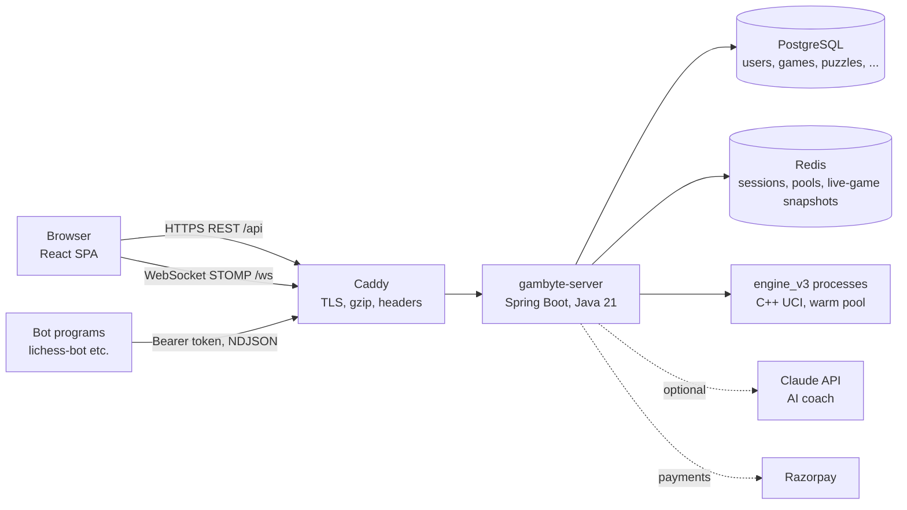
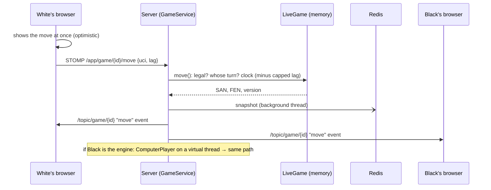

# Gambyte - architecture

Gambyte is the chess website built on this repository's engines: play people, bots and our own
engine; puzzles, lessons, game review with a coach; tournaments; premium; fair play.
This page explains how the pieces fit, so you can find your way around quickly.

## The parts

| Folder | What it is |
|---|---|
| `gambyte-server/` | The backend: one Spring Boot app (a *modular monolith*). |
| `gambyte-web/` | The frontend: React 19 + TypeScript + Vite + Tailwind. |
| `deploy/` | Docker images, Caddy config, local and production compose files. |
| `chess_engine_v1/` | Java rules (board, legal moves, SAN, PGN, draws) used by the server as **the** authority on legality. |
| `chess_engine_v3/` | The C++ engine the server runs for computer opponents, analysis and fair play. |

## Backend: one deployable, many features

Each feature is a package under `com.gambyte`, owning its controllers, services, entities and SQL:

| Package | Responsibility |
|---|---|
| `auth` | Login/logout/register, the session principal (`AuthUser`). |
| `user` | Accounts, profiles, settings, ratings, leaderboards, presence. |
| `game` | Live games (`LiveGame`, `ChessClock`), moves, endings, archive, PGN. |
| `lobby` | Quick pairing (Redis sorted sets) and challenges. |
| `rating` | Glicko-2 maths and applying it to games. |
| `engine` | `EnginePool` (warm UCI processes), `ComputerPlayer` (levels 1-8). |
| `bot` | API tokens and the Lichess-compatible Bot API (NDJSON streams). |
| `puzzle` | Puzzle serving and rating, importer, our engine-based `PuzzleMiner`. |
| `learn` | JSON lessons (validated at start-up) and progress. |
| `analysis` | Position eval, Game Review queue, `CoachExplainer`, optional AI coach. |
| `social` | Follows, notifications, reports, Gambyte TV. |
| `tournament` | Arena tournaments (pairing loop, scoring, hourly arena). |
| `payment` | Premium: `PaymentGateway` (Razorpay), webhooks, entitlements. |
| `fairplay` | Post-game engine comparison and flags for moderators. |
| `admin` | Moderation API, first-admin bootstrap. |
| `common`, `config`, `notification` | Errors, rate limiting, security, WebSocket, async, email. |

Rules (enforced by `ArchitectureTest`): features talk through **services** and **Spring events**,
never through another feature's repositories. Events in use:

- `GameEvents.GameStarted` → bot streams.
- `GameEvents.GameChanged` → bot streams.
- `GameEvents.GameFinished` → fair play, tournaments, bot streams.
- `ChallengeService.ChallengeCreated` → bot streams and notifications.

## How a move travels

**The server is the authority.** It checks every move with the v1 rules and runs the only clocks
that count. The browser's clocks only display a countdown. Every state change carries a
**version** number. A client that sees a gap, or reconnects, fetches the full snapshot again, so
the game self-heals without any merge logic.

**Where game state lives:**

| When | Where | Why |
|---|---|---|
| During the game | `LiveGameStore` (memory), plus a Redis snapshot after each change | Moves are served from memory, with no database round trip. The snapshot means a restart loses nothing. |
| At the end | A single write to Postgres (`games`) | Ratings are applied in the same transaction. |

## Speed and resilience techniques (where to find them)

| Technique | Where |
|---|---|
| Java 21 virtual threads for requests, `@Async`, the engine and background writers | `application.yml`, `AsyncConfig`, `GameService`, `LiveGameStore` |
| Warm engine-process pool with back-pressure (503 "engine busy" instead of overload) | `EnginePool` |
| In-memory live games with Redis snapshots, and Postgres written once per game | `LiveGameStore`, `GameService.finish` |
| Caffeine cache (leaderboards, engine user, daily puzzle, themes) | `@Cacheable` in `UserService`, `PuzzleService` |
| Keyset pagination for archives; indexes for every hot query | `GameRepository.archive`, `db/migration` |
| Durable job queues in Postgres (`FOR UPDATE SKIP LOCKED`) for reviews and fair play | `ReviewService`, `FairPlayService` |
| Rate limiting (token buckets) on login, moves, challenges, analysis… | `RateLimiter` |
| Redis sorted sets for pairing (range by rating), TTL keys for presence | `MatchmakingService`, `PresenceService` |
| Lag-compensated clocks, first-move timer, abandonment detection | `ChessClock`, `LiveGame`, `AbandonWatcher` |
| Code-split frontend, long-cached hashed assets, gzip/zstd | `App.tsx` (lazy), `vite.config.ts`, `Caddyfile` |

## Data model (Flyway migrations)

| Migration | Tables |
|---|---|
| `V1__users.sql` | `users`, `ratings`, `email_tokens`, plus the `GambyteEngine` bot row |
| `V2__api_tokens.sql` | Bot and API tokens (hashed) |
| `V3__games.sql` | `games` |
| `V4__puzzles.sql` | `puzzles`, `puzzle_attempts`, `puzzle_rush_runs` |
| `V5__reviews.sql` | `game_reviews` (also the review job queue) |
| `V6__learn_social.sql` | `lesson_progress`, `follows`, `notifications`, `reports` |
| `V7__payments.sql` | `subscriptions`, `payment_events` (webhook idempotency) |
| `V8__tournaments_fairplay.sql` | `tournaments`, `tournament_players`, `fairplay_checks`, blur counts on `games` |

Never edit a migration that has run anywhere. Add `V9__...sql` instead.

## Frontend

- **Layout:**
  - `src/features/<feature>/` holds each feature's pages, hooks and components;
  - `src/lib/` holds `api.ts` (fetch + CSRF), `ws.ts` (one shared STOMP connection), `chess.ts` and `sound.ts`;
  - `src/components/` holds the layout pieces.
- **Server data:** TanStack Query. **Live data:** `subscribe()` from `lib/ws.ts`.
- **The board:** `features/game/Board.tsx` wraps react-chessboard and adds click-to-move, legal-move dots, premoves and promotion.

## Where to start reading

1. `GameService` + `LiveGame`: the heart of playing.
2. `SecurityConfig`: who may call what.
3. `features/game/useLiveGame.ts`: the client half of a live game.
4. `docs/RUNBOOK.md`: running it locally and on AWS.
