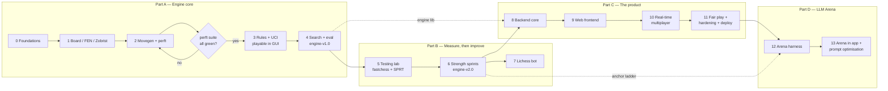
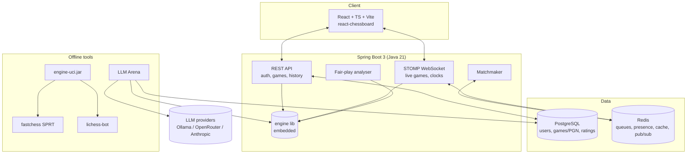
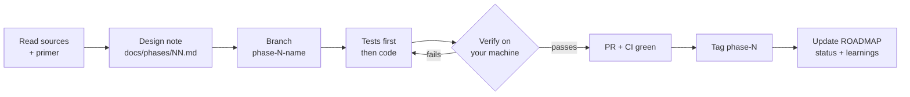
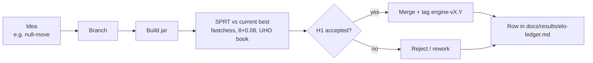

# Chess_Engine_App — Roadmap

> A chess.com-style platform built from scratch: **our own Java chess engine**, a **Spring Boot**
> backend with real-time matchmaking, a **React** frontend, **fair-play (anti-cheat)** checks, and an
> **LLM Arena** where language models play each other and our engine.
>
> The project is learning-first. It is built in strict phases, and every phase ends with something
> you can **run or load on your own machine**.

**Status legend:** ⬜ not started · 🟨 in progress · ✅ done

| # | Phase | Part | Output you can load/run | Status |
|---|-------|------|-------------------------|--------|
| 0 | Foundations | A · Engine | `mvn verify` green locally + CI | ⬜ |
| 1 | Board, FEN, Zobrist | A · Engine | `engine.jar` → `position fen …` / `d` prints board + hash | ⬜ |
| 2 | Move generation + perft | A · Engine | `go perft 5` = 4,865,609 · `bench` nps | ⬜ |
| 3 | Rules + playable UCI engine | A · Engine | Load in Cute Chess GUI and play a full game | ⬜ |
| 4 | Search & eval v1 | A · Engine | `engine-v1.0` beats random bot, solves tactic suite | ⬜ |
| 5 | Testing lab (SPRT) | B · Strength | `sprt.ps1 v1.0 v0` → result + Elo ledger row | ⬜ |
| 6 | Strength sprints | B · Strength | `engine-v2.0`, every feature proven in ledger | ⬜ |
| 7 | Lichess bot | B · Strength | Challenge your bot on lichess.org | ⬜ |
| 8 | Backend core | C · Product | `docker compose up` + play a game via Swagger UI | ⬜ |
| 9 | Web frontend | C · Product | `npm run dev` → play vs engine at localhost:5173 | ⬜ |
| 10 | Real-time multiplayer | C · Product | Two browser windows matched, timed game, ratings move | ⬜ |
| 11 | Fair play, hardening, deploy | C · Product | Public URL + fair-play report on a suspicious game | ⬜ |
| 12 | LLM Arena harness | D · Arena | `arena run …` → PGN + JSON token/legality report | ⬜ |
| 13 | Arena in app + prompt optimisation | D · Arena | Arena leaderboard page + experiment ledger | ⬜ |

---

## 1. Big picture

### 1.1 Phase flow



Part C needs a strong engine (v2.0) for the "play vs computer" levels and for fair-play analysis.
Part D needs the deployed product and the engine versions, which serve as fixed-strength rating anchors.

### 1.2 Target architecture



### 1.3 Repository layout (end state)

```
Chess_Engine_App/
├─ pom.xml          Maven parent (multi-module)
├─ engine/          pure Java library, zero dependencies: board, movegen, search, eval
├─ engine-uci/      thin UCI wrapper → runnable jar (loads in any chess GUI)
├─ tools/           perft runner, bench, SPRT scripts, opening-book builder
├─ server/          Spring Boot app (REST + WebSocket), depends on engine
├─ arena/           LLM Arena harness, depends on engine
├─ web/             React + TypeScript + Vite frontend
├─ deploy/          docker-compose.yml, Caddyfile, env templates
└─ docs/            ROADMAP, learn/ primers, adr/ decisions, phases/ notes, results/ ledgers
```

The `engine` module is the heart of the project. Everything else (UCI, server, fair-play, arena)
reuses it instead of re-implementing chess rules, so there is only one source of truth for legality.

---

## 2. How every phase is run

### 2.1 Per-phase loop



### 2.2 Rules

1. **One phase at a time.** Nothing from phase N+1 leaks into phase N.
2. **Read first.** Every phase lists sources. Where no good source exists, a primer is written in
   `docs/learn/` *before* the phase starts.
3. **Definition of Done:** tests pass, the *Verify* commands work on your machine, CI is green, and the
   phase notes are updated with what was built, what was learned and any open questions.
4. **Frozen foundations.** A finished phase is protected by its tests. If a later phase breaks it,
   fix that first; don't work around it.
5. **Decisions are recorded.** Any non-obvious choice gets a short ADR in `docs/adr/`.
6. **Branches and tags:** `phase-N-name` branches, `phase-N` tags; engine strength releases are tagged `engine-vX.Y`.

### 2.3 Engine improvement loop (Phase 5 onward)



A feature that doesn't *prove* an Elo gain doesn't get merged. Lague tested by eye and
self-play counts. We use the same statistics Stockfish uses.

---

## 3. Phases in detail

### Part A — Engine core

#### Phase 0 — Foundations
**Goal:** a clean, professional skeleton so every later phase builds and tests the same way.

- **Build:**
  - Maven multi-module parent targeting Java 21, with `engine` and `engine-uci` modules (the others are added in their own phases).
  - JUnit 5 and AssertJ, plus Spotless (google-java-format) so formatting is never debated.
  - GitHub Actions workflow running `mvn verify` on every push and PR.
  - `.gitignore`, `.editorconfig`, a README quick-start, and the ADR template.
- **Read:** [Maven multi-module guide](https://maven.apache.org/guides/mini/guide-multiple-modules.html), [GitHub Actions for Java/Maven](https://docs.github.com/en/actions/use-cases-and-examples/building-and-testing/building-and-testing-java-with-maven).
- **Verify on your machine:**
  ```bash
  mvn -q verify            # BUILD SUCCESS, sample test passes
  ```
  Then push the branch and see the green check on the PR.
- **Exit:** CI is green on `main`, and README explains how to build.

#### Phase 1 — Board representation, FEN, Zobrist
**Goal:** the engine can hold any legal chess position, read and write it as FEN, and hash it.

- **Build:**
  - **Bitboards from day one:** 12 piece bitboards (`long`), 2 colour occupancies and one all-occupancy, plus a `mailbox[64]` for O(1) "what piece is on square X".
    This is Lague's V2 hybrid design; his V1 array-only board was the thing he had to rewrite.
  - Square indexing `a1 = 0 … h8 = 63`, with piece and colour encoding.
  - `Move` as a 16-bit value `FFFF TTTTTT SSSSSS` (flag, target, start), using V2 flag numbering:
    `0 none, 1 en passant, 2 castle, 3 pawn double push, 4–7 promote Q/N/R/B`.
    That makes "is promotion" a single `flag >= 4` check.
  - FEN parse and emit, covering every field: side to move, castling, en-passant, halfmove and fullmove.
  - Zobrist keys, initialised from a fixed seed so they are reproducible.
  - Pretty-printing the board.
  - Minimal `engine-uci` main supporting `position fen …` and the debug command `d`.
- **DSA spotlight:** bitboards vs arrays; `Long.bitCount` / `numberOfTrailingZeros` / `x & (x-1)` loops;
  why XOR hashing allows incremental updates (A⊕B⊕B = A); 64-bit collision probability.
- **Read:** [Bitboards](https://www.chessprogramming.org/Bitboards) ·
  [Board Representation](https://www.chessprogramming.org/Board_Representation) ·
  [FEN](https://www.chessprogramming.org/Forsyth-Edwards_Notation) ·
  [Zobrist Hashing](https://www.chessprogramming.org/Zobrist_Hashing) ·
  primer [`docs/learn/01-board-fen-move-encoding.md`](learn/01-board-fen-move-encoding.md).
- **Verify on your machine:**
  ```bash
  mvn -q package
  java -jar engine-uci/target/engine-uci.jar
  position fen r3k2r/p1ppqpb1/bn2pnp1/3PN3/1p2P3/2N2Q1p/PPPBBPPP/R3K2R w KQkq - 0 1
  d
  ```
  You'll see an ASCII board, the same FEN echoed back, and a 64-bit hash.
- **Tests:** FEN round-trip on 50+ positions, and the Move encode/decode table.
- **Exit:** every FEN in the test corpus round-trips exactly.

#### Phase 2 — Move generation, make/unmake, perft
**Goal:** a *fully correct* legal move generator, proven against known node counts.

- **Build:**
  - Precomputed attack tables for king, knight and pawn.
  - Sliding pieces in two steps. **Step 1:** a simple ray loop, which is easy to get correct. **Step 2:**
    **magic bitboards with our own magic-number finder.** Lague hard-coded his magics; we generate ours and
    check that both methods agree on random positions.
  - Legal generation using check masks and pin rays.
    In double check only king moves are generated. The king can't retreat along a checking ray, and the
    en-passant horizontal-pin edge case is handled.
  - `makeMove` / `unmakeMove` with an irreversible-state stack (castling, en passant, captured piece,
    halfmove clock, hash). Allocation-free in the hot path: moves are `int`s in reusable `int[]` buffers.
  - `perft`, `divide` (per-move counts, for debugging) and `bench` (nodes/sec).
- **DSA spotlight:** precomputation vs computing on the fly; perfect hashing (magics); why
  allocation-free buffers matter on the JVM; recursion/DFS (perft is a DFS over the game tree).
- **Read:** [Move Generation](https://www.chessprogramming.org/Move_Generation) ·
  [Magic Bitboards](https://www.chessprogramming.org/Magic_Bitboards) ·
  [Perft Results](https://www.chessprogramming.org/Perft_Results) ·
  Lague V2 `src/Core/Move Generation/` ([repo](https://github.com/SebLague/Chess-Coding-Adventure/tree/Chess-V2-UCI)).
- **Verify on your machine:**
  ```bash
  java -jar engine-uci/target/engine-uci.jar
  position startpos
  go perft 5               # → 4865609
  bench                    # → prints nodes/sec (first performance baseline)
  ```
- **Tests (JUnit perft suite):**

  | Position | Depth | Nodes |
  |---|---|---|
  | Start | 5 | 4,865,609 |
  | Kiwipete | 4 | 4,085,603 |
  | Position 3 | 5 | 674,624 |
  | Position 4 | 4 | 422,333 |
  | Position 5 | 4 | 2,103,487 |
  | Position 6 | 4 | 3,894,594 |

  Deeper runs are tagged `@Tag("slow")` and run in CI nightly.
- **Exit:** the whole perft suite is green, and the magic and ray generators agree on 10,000 random positions.

#### Phase 3 — Rules + playable UCI engine
**Goal:** the first "load it and play" milestone, inside a real chess GUI.

- **Build:**
  - Game-end detection: checkmate, stalemate, 50-move rule, threefold repetition (by Zobrist history),
    and insufficient material.
  - SAN (`Nf3`, `exd5`, `O-O`, `e8=Q+`) in both directions, plus PGN writing.
  - Full UCI: `uci`, `isready`, `ucinewgame`, `position startpos|fen … moves …`,
    `go depth|movetime|wtime/btime/winc/binc|infinite`, `stop`, `quit`, and `setoption` (Hash).
    Lague's V2 UCI was "barebones": no `go depth`, no perft.
  - `RandomPlayer` as engine v0, so the GUI has something to play against.
- **Read:** [UCI protocol](https://backscattering.de/chess/uci/) ·
  [SAN](https://www.chessprogramming.org/Algebraic_Chess_Notation) ·
  [Cute Chess](https://cutechess.com/).
- **Verify on your machine:** install **Cute Chess GUI** (Windows). Add an engine with
  command `java -jar <path>\engine-uci.jar`, start a new game against it, play to the end, and save the PGN.
- **Exit:** a full game is played in the GUI with no protocol errors, and end-of-game rules are tested.

#### Phase 4 — Search & evaluation v1 → `engine-v1.0`
**Goal:** a real thinking engine.

- **Build:**
  - Negamax with alpha-beta and fail-soft returns, **quiescence search** (captures only, stand-pat),
    and **iterative deepening** that keeps the best move from the last completed depth.
  - Move ordering: hash move, then **MVV-LVA** captures, then promotions, then quiet moves.
  - **Transposition table** done properly, fixing Lague's issues:
    - depth-preferred replacement with aging (Lague used always-replace);
    - mate scores adjusted by ply on store and load;
    - size set in MB;
    - real use of stored bounds (Lague's V2 lookup was a stub that always returned false).
  - Repetition detection *inside* the search, and 50-move draw scoring.
  - **Time management:** `remaining/30 + increment·0.8`, with a hard stop and a check every N nodes.
  - Evaluation: **PeSTO tapered** middlegame and endgame piece-square tables, with game-phase interpolation.
- **DSA spotlight:** move ordering by full sort vs a priority queue / heap vs **lazy selection sort**.
  We pick lazy selection because most nodes cut off after one or two moves, so sorting everything is wasted work.
  The TT is an open-addressed, fixed-size hash table with a replacement policy, essentially a cache.
- **Read:** [Alpha-Beta](https://www.chessprogramming.org/Alpha-Beta) ·
  [Quiescence Search](https://www.chessprogramming.org/Quiescence_Search) ·
  [Iterative Deepening](https://www.chessprogramming.org/Iterative_Deepening) ·
  [Transposition Table](https://www.chessprogramming.org/Transposition_Table) ·
  [MVV-LVA](https://www.chessprogramming.org/MVV-LVA) ·
  [PeSTO](https://www.chessprogramming.org/PeSTO%27s_Evaluation_Function) ·
  [MinimalChessEngine](https://github.com/lithander/MinimalChessEngine) (clean C# engine inspired by Lague).
- **Verify on your machine:**
  ```bash
  java -jar engine-uci/target/engine-uci.jar
  position fen 6k1/5ppp/8/8/8/8/5PPP/3R2K1 w - - 0 1
  go depth 6               # → bestmove d1d8 (back-rank mate)
  ```
  Then play it in Cute Chess: it should crush you or v0.
- **Tests:** a mate-in-1/2/3 suite and a tactics EPD subset (e.g. Win At Chess) with a pass-rate threshold.
- **Exit:** tag **`engine-v1.0`**.

### Part B — Measure, then improve

#### Phase 5 — Testing lab
**Goal:** objective, statistical proof of strength. Lague's version-vs-version manager was never finished
(it's commented out in his repo); this is the industry-standard version.

- **Build:**
  - Download [fastchess](https://github.com/Disservin/fastchess) (Windows binary) and an opening book from
    [official-stockfish/books](https://github.com/official-stockfish/books) (UHO or 8moves).
  - `tools/sprt.ps1 <new> <base>`: runs normalised SPRT with bounds `[0, 5]`, α = β = 0.05, at 8+0.08,
    using the book with both colours.
  - A `versions/` registry, where each `engine-vX.Y` tag builds into `versions/engine-vX.Y.jar`.
  - `tools/ledger` appends results to **`docs/results/elo-ledger.md`**
    (feature · Elo ± error · games · W/D/L · LLR · accepted?).
    This is your "table of results" idea from Learnings 2, automated.
  - *Optional creative extra:* `tools/book-builder.py` takes positions from the Lichess open database, keeps
    only balanced ones (|eval| < 50cp by Stockfish) and writes our own book. This is Lague's approach, done as a reusable tool.
- **DSA spotlight:** sequential hypothesis testing; why fixed game counts waste compute.
- **Read:** [SPRT](https://www.chessprogramming.org/Sequential_Probability_Ratio_Test) ·
  [fastchess README](https://github.com/Disservin/fastchess) ·
  primer `docs/learn/05-sprt-explained.md`.
- **Verify on your machine:**
  ```powershell
  tools\sprt.ps1 engine-v1.0 engine-v0
  ```
  Expect H1 accepted almost instantly and a new ledger row.
- **Exit:** a one-command SPRT plus the ledger work end to end.

#### Phase 6 — Strength sprints → `engine-v2.0`
**Goal:** climb in Elo, one proven feature at a time. Each bullet below is one mini-branch and one SPRT.

- **Search:** killer moves + history heuristic → PVS → **null-move pruning** → **late move reductions**
  → check extensions → aspiration windows → (stretch) futility / reverse futility pruning.
- **Eval:** passed pawns (bitboard masks) → isolated and doubled pawns → **king safety**
  (pawn shield + open files + attackers; Lague skipped it, you asked for it) → mobility → bishop pair →
  mop-up endgame.
- **Stretch:** Texel tuning, i.e. fitting the eval weights to game results with simple gradient descent.
- **Read:** chessprogramming pages on
  [Killer](https://www.chessprogramming.org/Killer_Heuristic) ·
  [History](https://www.chessprogramming.org/History_Heuristic) ·
  [PVS](https://www.chessprogramming.org/Principal_Variation_Search) ·
  [Null Move](https://www.chessprogramming.org/Null_Move_Pruning) ·
  [LMR](https://www.chessprogramming.org/Late_Move_Reductions) ·
  [Aspiration Windows](https://www.chessprogramming.org/Aspiration_Windows) ·
  [Passed Pawn](https://www.chessprogramming.org/Passed_Pawn) ·
  [King Safety](https://www.chessprogramming.org/King_Safety) ·
  [Texel Tuning](https://www.chessprogramming.org/Texel%27s_Tuning_Method).
- **Verify on your machine:** each sprint has its own ledger row, and a final gauntlet of `v2.0` vs `v1.0`
  shows a large, significant gain.
- **Exit:** tag **`engine-v2.0`**.

#### Phase 7 — Lichess bot
**Goal:** the engine plays real people online.

- **Build:**
  - [lichess-bot](https://github.com/lichess-bot-devs/lichess-bot) bridge config pointing at our UCI jar.
  - Our `config.yml` template, with no secrets committed.
  - A run script.
- ⚠️ **Upgrading an account to BOT is irreversible.** Create a fresh Lichess account that has played no games.
  The API token needs the `bot:play` scope and stays in an env var, never in git.
- **Verify on your machine:** run the bridge, then challenge the bot from your personal account and watch it play.
- **Exit:** the bot has played 20+ rated games; record its rating in the ledger.

### Part C — The product

#### Phase 8 — Backend core
**Goal:** a secure Spring Boot API where you can play the engine, with games stored.

- **Build:**
  - The `server` module: Spring Boot 3 / Java 21, Spring Web, Spring Data JPA, Flyway, Spring Security
    (session cookies + CSRF; see ADR-0004).
  - `deploy/docker-compose.yml` with **PostgreSQL** and **Redis**.
  - Schema: `users`, `games` (PGN, result, termination, time control, ratings before and after, final FEN).
  - REST endpoints: register/login, `POST /games` (vs engine at a level), `POST /games/{id}/moves`
    (validated by the `engine` lib), `GET /games/{id}` (with PGN).
  - Engine "levels" come from depth and time limits plus a little randomness at low levels.
  - OpenAPI / Swagger UI, and Testcontainers integration tests.
- **DSA / design spotlight:** layered architecture (controller → service → repository); DTOs vs entities;
  why the server is the only authority on legality.
- **Read:** [Spring Boot reference](https://docs.spring.io/spring-boot/reference/) ·
  [Spring Security architecture](https://docs.spring.io/spring-security/reference/servlet/architecture.html) ·
  [Testcontainers + Spring Boot](https://docs.spring.io/spring-boot/reference/testing/testcontainers.html).
- **Verify on your machine:**
  ```bash
  docker compose -f deploy/docker-compose.yml up -d
  mvn -pl server spring-boot:run
  ```
  Open http://localhost:8080/swagger-ui.html, register, create a game and play moves.
- **Exit:** integration tests are green, and a game survives a server restart.

#### Phase 9 — Web frontend
**Goal:** a good-looking site where you play the engine.

- **Build:**
  - `web/`: React + TypeScript + Vite, using [react-chessboard](https://github.com/Clariity/react-chessboard)
    (MIT; chessground is GPL-3, see ADR-0003).
  - Pages: login/register, lobby, play vs computer (level picker), game view with move list, eval bar,
    PGN export, game history, and profile.
  - Vitest unit tests and a Playwright smoke test (log in → play 3 moves).
- **Read:** [React docs](https://react.dev/learn) · [Vite guide](https://vite.dev/guide/) ·
  [react-chessboard](https://github.com/Clariity/react-chessboard).
- **Verify on your machine:**
  ```bash
  cd web && npm install && npm run dev
  ```
  Open http://localhost:5173 and play a full game against the engine.
- **Exit:** the Playwright smoke test passes in CI.

#### Phase 10 — Real-time multiplayer
**Goal:** human vs human, live, with clocks and ratings, like chess.com.

- **Build:**
  - **STOMP over WebSocket.** Topic `/topic/game/{id}` carries moves, clocks and results; a user queue
    carries match-found events.
  - **Matchmaker on Redis:** one sorted set per time control, scored by rating. The acceptable rating window
    **widens the longer you wait**.
  - **Presence:** Redis keys with TTL refreshed by heartbeat.
  - **Server-authoritative clocks:** the server timestamps each move and runs a scheduled flag check.
    Client clocks are display only.
  - **Reconnect:** the client gets a full state snapshot (FEN, moves, clocks, version). An abandonment
    timer lets the opponent claim victory.
  - **Glicko-2** ratings (as on Lichess), plus a leaderboard cached in Redis.
- **DSA spotlight:** sorted sets (skip lists) for range queries by rating; TTL as a liveness detector;
  where caching helps and where it causes stale data.
- **Read:** [Spring WebSocket/STOMP](https://docs.spring.io/spring-framework/reference/web/websocket/stomp.html) ·
  [Redis sorted sets](https://redis.io/docs/latest/develop/data-types/sorted-sets/) ·
  [Lichess rating systems](https://lichess.org/page/rating-systems) ·
  [Glicko-2 paper](http://www.glicko.net/glicko/glicko2.pdf).
- **Verify on your machine:** open two browser windows (one normal, one incognito) as two users, join the same
  time control, and get matched. Play a timed game, let one clock run out, and check both ratings changed.
- **Exit:** clock, flag, reconnect and abandonment scenarios are covered by integration tests.

#### Phase 11 — Fair play, hardening, deploy
**Goal:** a live, secure site with the anti-cheat system from the README.

- **Fair-play analyser** (reuses our engine, so no Stockfish is needed). After each rated game it computes:
  - **engine top-move match rate**;
  - **average centipawn loss**;
  - **move-time consistency**;
  - client signals such as tab focus loss.

  Accounts are flagged when results are statistically unlikely for their rating, and the evidence is shown on
  an admin review page. Nothing is banned automatically.
- **Hardening:**
  - Rate limiting (Bucket4j), input validation, CSRF, secure cookies.
  - Secrets only in env vars, dependency scanning (Dependabot), and an OWASP checklist in `docs/security.md`.
- **Ops:** Spring Actuator health and metrics, structured JSON logs, Docker images for server and web, and
  Caddy for automatic HTTPS.
- **Deploy:** Docker Compose on **Oracle Cloud Always Free** (ARM) or a ~$5 VPS.
  Render's free tier is fine for a demo only: it sleeps when idle, which drops WebSockets, and its free
  Postgres expires after 30 days.
- **Read:** [OWASP Top 10](https://owasp.org/www-project-top-ten/) ·
  [Caddy reverse proxy](https://caddyserver.com/docs/quick-starts/reverse-proxy) ·
  primer `docs/learn/11-fair-play-statistics.md`.
- **Verify on your machine:**
  - First the full stack locally: `docker compose -f deploy/docker-compose.prod.yml up`.
  - Then the public URL. Play a game where you deliberately copy engine moves and see it flagged.
- **Exit:** the site is live over HTTPS, the security checklist is ticked, and the fair-play report works.

### Part D — LLM Arena

#### Phase 12 — Arena harness
**Goal:** a fair, reproducible benchmark of how well LLMs play chess, and how cheaply.

- **Build:**
  - **Provider adapters:**
    - **Ollama**: local and free, so the whole harness can be verified at zero cost;
    - **OpenRouter**: OpenAI-compatible, which covers most commercial and open models;
    - **Anthropic**.
  - **Prompt strategies** you can plug in and A/B test:
    - PGN move history;
    - FEN;
    - ASCII board;
    - "ask for legal moves" as an *on-demand* action.

    Research note: putting the full legal-move list into *every* prompt made models much worse (dynomight), while a
    PGN history works best for instruct models.
  - **Rules:**
    - each game allows at most 3 illegal or unparseable moves, then the model forfeits;
    - tools and function-calling are disabled;
    - every raw request and response is logged;
    - every move is validated by our engine;
    - the prompts never mention or use Stockfish.
  - **Memory over long games:** compare a full PGN each turn with a compact "FEN + last N moves" format.
    Measure both quality and tokens.
  - **Metrics per move:** tokens in and out, cost, latency, illegal attempts, centipawn loss (judged by our
    engine), and top-move match rate.
  - **Opponents:**
    - LLM vs LLM round-robin with both colours;
    - LLM vs an **anchor ladder of our own engine versions/levels** (v0 random, v1@depth1, v1@depth3, v2…).
      This gives fixed, free, reproducible rating anchors.
  - **Ratings:** Bradley-Terry / BayesElo fit across all games, with confidence intervals.
- **Read:** [maxim-saplin/llm_chess](https://github.com/maxim-saplin/llm_chess) ·
  [dynomight: LLMs and chess](https://dynomight.net/chess/) and [follow-up](https://dynomight.net/more-chess/) ·
  [Karvonen: chess world models](https://adamkarvonen.github.io/machine_learning/2024/01/03/chess-world-models.html) ·
  [Kaggle Game Arena chess](https://www.kaggle.com/benchmarks/kaggle/chess-text) ·
  primer `docs/learn/12-llm-arena-design.md`.
- **Verify on your machine:**
  ```bash
  ollama pull llama3.2
  java -jar arena/target/arena.jar run --white ollama:llama3.2 --black engine:v1.0@depth1 --games 2
  ```
  This writes `arena/out/<run>/games.pgn` and `report.json` (tokens, cost, illegal-move rate, ACPL).
- **Exit:** a reproducible run gives the same report from the same seed and logs.

#### Phase 13 — Arena in the app + prompt optimisation
**Goal:** show the arena publicly and make LLM play cheaper and better.

- **Build:**
  - An Arena leaderboard page, a live LLM-game viewer (spectate over WebSocket), and per-model stats.
  - An **experiment ledger** (`docs/results/arena-ledger.md`), the twin of the Elo ledger.
    It records each prompt change with tokens/game, score and illegal-move rate, before and after.
  - Experiments:
    - prompt compaction;
    - strict response format (move only);
    - few-shot vs zero-shot;
    - forced opening variety (Kaggle saw every model play the Sicilian);
    - reasoning-effort caps for reasoning models.
- **Verify on your machine:** open `/arena` in the web app, watch a live LLM game, and read an experiment row
  showing a token reduction with no loss in score.
- **Exit:** at least three accepted optimisations are in the ledger.

### Stretch goals (after Phase 13, optional)
- **NNUE** evaluation (train with [bullet](https://github.com/jw1912/bullet)), the biggest single strength jump.
- **Lazy SMP** multithreaded search.
- A documentation site (MkDocs Material) built from `docs/`, covering your "documentation so anyone can extend
  it" objective.
- Puzzles mode, made from positions where our fair-play analyser saw big centipawn swings.

---

## 4. What we take from Sebastian Lague — and what we do differently

| Topic | Lague V1 (2021) | Lague V2 (2023, branch `Chess-V2-UCI`) | This project |
|---|---|---|---|
| Board | `int[64]` + piece lists | + bitboards | Bitboards + mailbox from day one |
| Sliders | Ray loops | Hard-coded magics | Ray loops → own magic finder, cross-checked |
| Testing correctness | Perft in Unity | No tests in repo | JUnit perft suite in CI |
| Transposition table | Always-replace, cleared each move (suspected bug) | Always-replace, lookup stubbed | Depth-preferred + aging, mate-ply fix |
| Pruning / reductions | None | LMR, check ext. | + PVS, null-move, aspiration, futility |
| Eval | PST + mop-up | + passed/isolated pawns, pawn shield | + king safety, mobility, bishop pair, tuning |
| Version testing | Commented out | None in repo | fastchess + SPRT + Elo ledger |
| UCI | — | Barebones | Full (depth, perft, options) |

Learnings 2 linked "the GitHub `main` branch". The V2 code is actually on
[`Chess-V2-UCI`](https://github.com/SebLague/Chess-Coding-Adventure/tree/Chess-V2-UCI) (the repo's default branch).

---

## 5. Decisions (ADRs)
- [ADR-0001 — Java 21 for the engine](adr/0001-java-engine.md)
- [ADR-0002 — Maven multi-module monorepo](adr/0002-monorepo.md)
- [ADR-0003 — react-chessboard over chessground](adr/0003-react-chessboard.md)
- [ADR-0004 — Session-cookie auth over JWT](adr/0004-session-auth.md)

The Eraser board (original learnings + mirrored diagrams):
https://app.eraser.io/workspace/1dlGrfXL6QtQMgK64YgD
