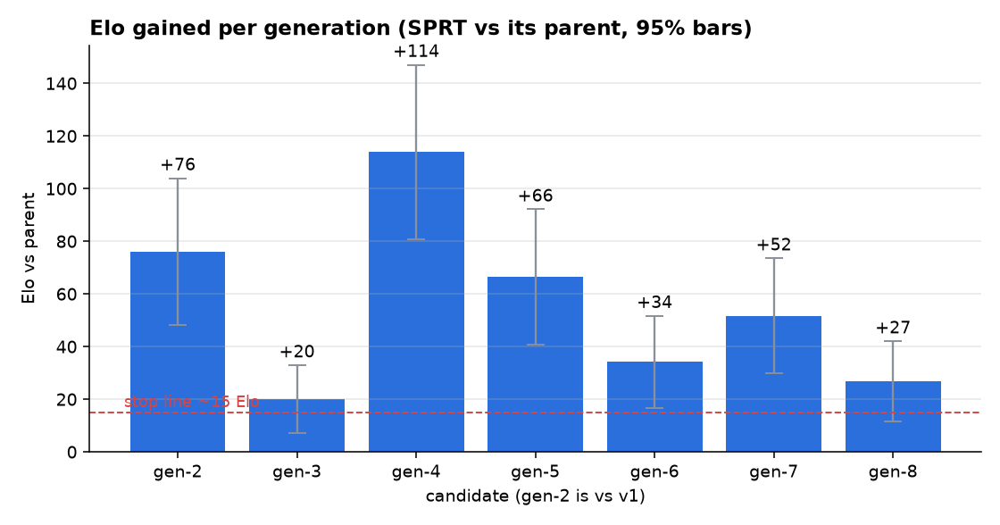
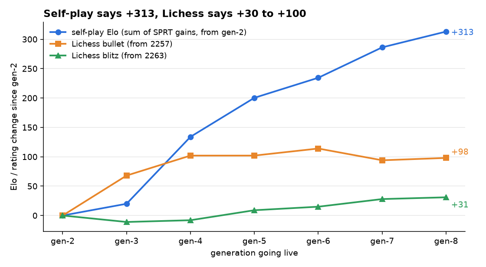
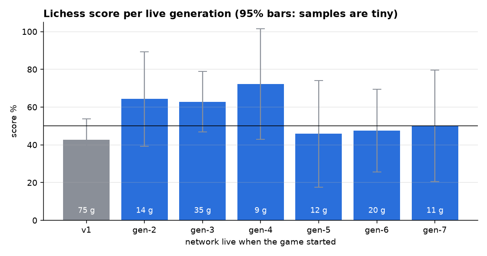
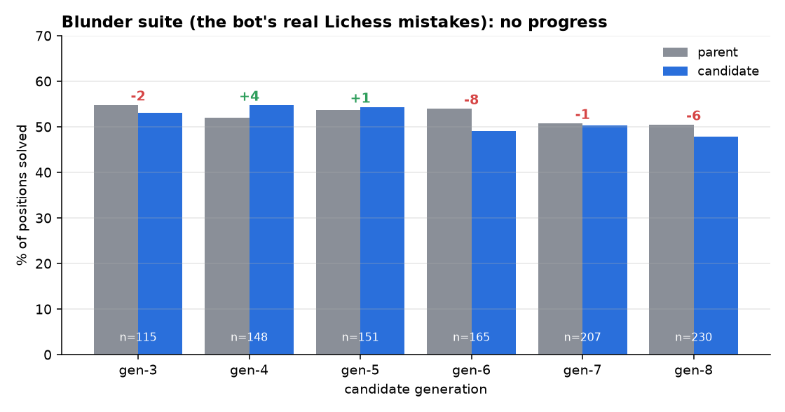
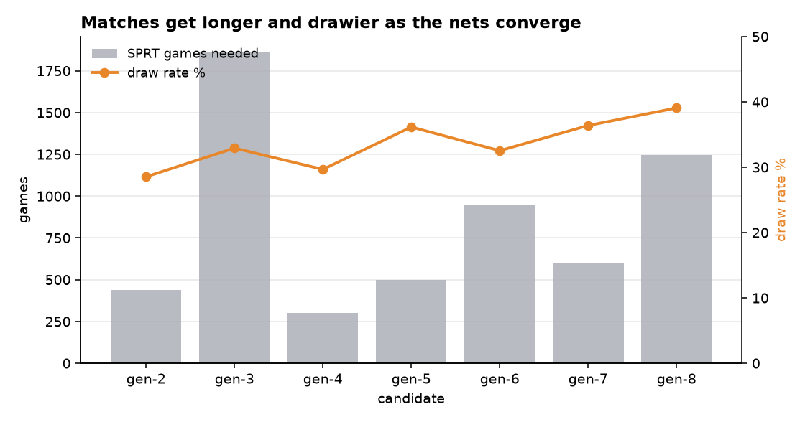

# Generation review: gen-2 to gen-8 (2026-11-06)

**The question:** do the generations really get stronger, or does it only look that way when each one plays its own parent? And does Lichess confirm it?

**Data used:**
- `chess_engine_v2/nets/registry.json`: SPRT results, blunder suite, and the Lichess rating at each promotion.
- `docs/results/lichess-by-generation.md`.
- The live Lichess profile on 2026-11-06: bullet 2360 (RD 58, 47 games), blitz 2300 (RD 45, 147 games).

To regenerate the graphs, run `python tools/plot_generations.py`.

## Verdict in one paragraph

**Part real, mostly inflated.**
- **The real part:** the jump from v1 to the first NNUE generations shows up everywhere:
  - SPRT gave +76.
  - The Lichess score went from 43% to about 65%.
  - Bullet rose by 100 points within a day.
- **The inflated part:** from gen-4 on, self-play adds about **+180 Elo** while Lichess barely moves:
  - bullet stayed flat at 2359 → 2360;
  - blitz went 2255 → 2300, which is +45 but inside one rating deviation (±45);
  - the blunder suite of the bot's own Lichess mistakes got slightly **worse**.
- **Why:** each generation has only ever been tested against its own parent. Self-play gains measured that way are known to overstate strength against anyone else. A gauntlet against the old generations will tell us by how much (see the plan).

## 1. All generations side by side

| Gen | Tested vs | W-L-D | Games | Elo vs parent (95%) | Sum since v1 | Draw % | Blunder suite cand / parent | Lichess games while live | Lichess score | Bullet / blitz when it went live |
|---|---|---|---|---|---|---|---|---|---|---|
| v1 | — | — | — | — | 0 | — | — | 75 | 42.7% | — |
| gen-2 | v1 | 204-109-125 | 438 | +76 ± 28 | +76 | 28.5% | — | 14 | 64.3% | 2257 / 2263 |
| gen-3 | gen-2 | 678-571-613 | 1862 | +20 ± 13 | +96 | 32.9% | 61 / 63 of 115 (−2) | 35 | 62.9% | 2325 / 2252 |
| gen-4 | gen-3 | 153-58-89 | 300 | +114 ± 33 | +210 | 29.7% | 81 / 77 of 148 (+4) | 9 | 72.2% | 2359 / 2255 |
| gen-5 | gen-4 | 206-112-180 | 498 | +66 ± 26 | +276 | 36.1% | 82 / 81 of 151 (+1) | 12 | 45.8% | 2359 / 2272 |
| gen-6 | gen-5 | 367-274-309 | 950 | +34 ± 18 | +310 | 32.5% | 81 / 89 of 165 (−8) | 20 | 47.5% | 2371 / 2278 |
| gen-7 | gen-6 | 236-147-219 | 602 | +52 ± 22 | +362 | 36.4% | 104 / 105 of 207 (−1) | 11 | 50.0% | 2351 / 2291 |
| gen-8 | gen-7 | 427-331-486 | 1244 | +27 ± 15 | +389 | 39.1% | 110 / 116 of 230 (−6) | live now | — | 2355 / 2294 (now 2360 / 2300) |

**How to read the Lichess columns:**
- The rating snapshot at "gen-N went live" was mostly *earned by the generation before it*, so ratings lag one generation behind.
- The "Sum since v1" column assumes Elo adds up across generations (gen-2 + gen-3 + …). That holds only if the gains carry over to opponents other than the parent, which is exactly what is in doubt.

## 2. Is there improvement? How much?

- **Every generation passed SPRT honestly.** None of the error bars touch zero.
- **The gains shrink:** taking pairs of generations, the gain goes +96 → +180 → +86 → +27.
  - gen-4 (+114) is an outlier. It was the first generation trained on two sets of NNUE self-play, which is a data effect and won't repeat.
  - gen-8's +27 ± 15 is close to the ~15 Elo point where a generation stops being worth 4–5 hours of laptop time.
- **Self-play says the net is saturating;** the end is 1–3 generations away.

## 3. Does it show on Lichess, or is it phantom?

- **From gen-2 to gen-8:**
  - self-play: **+313**
  - Lichess bullet: **+98**, and all of it happened in the first day (gen-2 and gen-3); flat since gen-4.
  - Lichess blitz: **+31**, a slow climb, still inside one rating deviation.
- **Some gap is expected even if every gain were real.** Engine-vs-engine Elo between near-identical engines is stretched compared with Elo against varied opponents: a factor of 2–3 is common. Even divided by 3, +313 would predict about +100 in blitz. We see +31.

- **The raw Lichess score is no help either.** Gens 2–4 scored about 65% over 58 games; gens 5–7 scored 48% over 43 games.
  - That is partly because the rating went up, so Lichess paired the bot with stronger bots.
  - Mostly it is because 9–35 games per generation is far too few: the 95% bars are ±20–30%.
- **Promotions happened faster than Lichess could measure them.** gen-4 was live for only 9 games and gen-7 for 11.

**Conclusion:** the gain from v1 to NNUE is real. Most of the self-play gain from gen-4 to gen-8 is not (yet) visible against other opponents. Some of it may be real but hidden by noise; some is probably inflation from always testing against the parent. Section 5 says how to separate the two.

## 4. Where we are lacking

1. **Real mistakes don't get fixed.**
   - Over six candidates, the blunder suite (positions the bot actually lost on Lichess) moved by −2, +4, +1, −8, −1, −6: **12 fewer solved than the parent overall.**
   - Three candidates (gen-6, gen-7, gen-8) solved fewer than their parent and were promoted anyway.
   - The candidates are getting better at beating their parent, not at the positions that cost real games.
2. **No check that the gains carry over to other opponents.** Nothing ever plays gen-8 against gen-2, gen-4 or v1, so the "+389" is a sum that has never been measured.
3. **The data is converging.**

   

   - The draw rate went 28% → 39%, and the SPRT needed 1244 games for gen-8.
   - The nets generate self-play from the same start positions with the same search, so each new data set looks more like the last.
   - The labels (5000 nodes) are shallow, so the network mostly learns to copy its parent's search.
4. **Lichess sample size.** About 100 games per day (the bot-vs-bot cap) spread over 2–3 generations a day means no generation gets enough games to be judged on Lichess.
5. **Bullet has been flat for 4 generations.** At bullet, search speed and time management matter more than evaluation, and neither has changed since gen-2.

## 5. Plan: what to do next

**Step 1: measure truthfully (no training, about 3–4 h). Do this first.**
- **Gauntlet:** gen-8 vs gen-2, gen-4, gen-6 and v1, a fixed 400 games each at 5+0.05 (not SPRT: we want a number, not a yes/no).
- **How to read the result:**
  - If gen-8 vs gen-2 comes out near **+300**, the gains are real and Lichess just hasn't caught up.
  - If it comes out near **+100**, two-thirds of the ladder is inflation.
- **Longer time control:** repeat gen-8 vs gen-4 at 60+0.6, closer to Lichess blitz, to see whether the gain holds when both sides search deeper.

**Step 2: freeze gen-8 on Lichess for about 2 days (~150–200 games)** before promoting anything else.
- This gives one generation a reliable Lichess result.
- The bot keeps playing as it does now; just don't run `tools\train` meanwhile. The gauntlet in step 1 can run in parallel at below-normal priority.

**Step 3: fix the loop before the next generation.** Run gen-9 only after these:
- **Diverse openings:** start self-play games from a book of varied, unbalanced positions (or 8–10 random opening plies) instead of the starting position, to break the draw convergence.
- **Deeper labels:** score positions at 10k–20k nodes instead of 5k (fewer positions, about 2M, is fine). This gives the net something its parent did not already know.
- **More weight on real games:** raise the Lichess position weight from 0.15 to about 0.3, and keep one older self-play set in the training mix.
- **Stricter gates:**
  - re-label the blunder suite with a deeper search, then drop the 10% tolerance: a candidate must not solve fewer positions than its parent;
  - add a mini-gauntlet: the candidate must also beat gen-(N−3) by at least its claimed sum.

**Step 4: stop rule (answers "how many generations").**
- **Stop adding generations** when either of these happens:
  - **two** generations in a row give an SPRT gain under ~15 Elo or fail;
  - the gauntlet in step 1 shows the gains are mostly inflation.
- **At the current rate that is after gen-9 or gen-10.**
- **Then move to techniques:**
  - **Bigger network:** a 512 hidden layer, king buckets and output buckets. This is the next real eval gain; it needs a re-train from the current data.
  - **Search:** move ordering, history and continuation history, LMR tuning, and singular extensions. These help every network.
  - **Time management for bullet:** this is where Lichess is flat.

| Step | Time | Output |
|---|---|---|
| 1. Gauntlet + long-time-control check | 3–4 h | the transitive Elo table, added to this doc |
| 2. Freeze gen-8 on Lichess | 2 days (parallel) | one generation with a reliable Lichess rating |
| 3. Loop fixes, then gen-9 | 1 day code + 5 h run | a candidate trained on more varied, deeper data |
| 4. Stop rule → bigger net / search | after gen-9/10 | the next real gain on Lichess |
